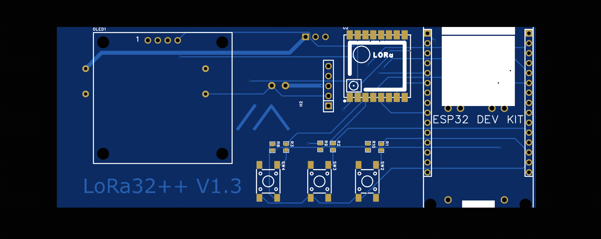
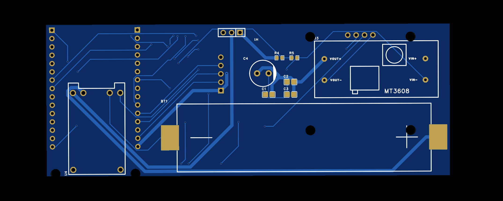

# LoRa32++ (V1.3)

**LoRa32++** is a compact, custom-built IoT device based on the ESP32, featuring LoRa communication, GPS tracking, and an OLED display. It is designed for portable tracking, long-range communication (such as Meshtastic nodes), or autonomous sensor applications.

Version **V1.3** represents a major milestone: the project has transitioned from breadboards to a custom Printed Circuit Board (PCB), making the device significantly more reliable, compact, and ready for real-world deployment.

## ✨ Features
*   **Microcontroller:** ESP32 (30-pin DevKit module used for easy replacement and soldering).
*   **LoRa:** Ai-Thinker Ra-02 (SX1278, 433MHz) with an external antenna via an IPEX-to-SMA pigtail.
*   **GPS:** ATGM336H (Multi-GNSS: GPS + BeiDou) for fast and accurate positioning.
*   **Display:** 1.3" OLED SH1106 (I2C).
*   **Power:** Li-Ion 18650 battery with TP4056 charging module and MT3608 boost converter (5V output).
*   **User Interface:** 2 programmable push buttons.

## 📸 Gallery
*(Make sure to add your images to `docs/images/` folder)*
| PCB Top | PCB Bottom |
| :---: | :---: |
|  |  |

## 📂 Project Structure
*   `firmware/` — Source code (PlatformIO / Arduino C++).
*   `hardware/` — EasyEDA project files, Gerber files, and BOM.
*   `docs/` — Documentation, images, and datasheets.
*   `HARDWARE.md` — Detailed hardware description and pinout.

## 🚀 Quick Start
1. Install [PlatformIO](https://platformio.org/) (recommended) or Arduino IDE.
2. Clone this repository.
3. Open the `firmware/LoRa32pp_V1.3` folder in PlatformIO.
4. Compile and upload the firmware to your ESP32.
5. **IMPORTANT:** Always attach the LoRa antenna before powering the board to avoid damaging the RF module.